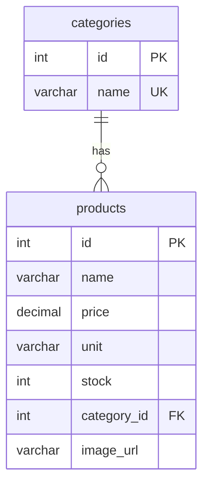

# Foodwell API

## Project Description

Foodwell is a RESTful Web service for an online grocery store that lets customers browse products, manage a shopping cart, and place orders for delivery. Store staff can manage inventory and update order status, while administrators oversee the product catalog and user accounts. The service is built around resource-oriented endpoints for products, categories, customers, carts, and orders, with a checkout flow that validates stock and calculates totals server-side. It gives a small grocery business a clean, well-documented API that a web or mobile client can consume to sell groceries online without custom integration work for every client.

## Team Members

| Name | Role / Responsibilities |
|---|---|
| Will Kerdy Elveus | Backend — Products & Categories endpoints, database schema |
| Sean Lussier | Backend — Customers & Authentication |
| Mohamed Amine | Backend — Cart & Order endpoints, checkout logic |

## Tech Stack

PHP 8+, Apache, MariaDB, Composer, PDO, OpenAPI 3.0. Planned: PHPUnit, Postman/Newman.

## Build 1 status

Build 1 = scaffolding + **GET one item** + **GET a list**, both database-backed, with a basic page and OpenAPI.

| Method | URI | Status |
|---|---|---|
| GET | `/api/v1/products` | implemented |
| GET | `/api/v1/products/{id}` | implemented |
| POST / PUT / DELETE | `/api/v1/products[/{id}]` | planned (Build 2) |
| GET / POST / DELETE | `/api/v1/categories[/{id}]` | planned (Build 2) |
| POST / GET / PUT | `/api/v1/customers[/{id}]` | planned (Build 2) |
| GET / POST / PUT / DELETE | `/api/v1/customers/{id}/cart[/items[/{itemId}]]` | planned (Build 2) |
| POST / GET / PATCH | `/api/v1/orders[/{id}]`, `/api/v1/customers/{id}/orders` | planned (Build 2) |
| GET / POST / PUT / DELETE | `/api/v1/delivery-slots[/{id}]` | planned (Build 3) |

Not implemented in Build 1 (assigned to Build 2/3 on the project board): filtering, sorting, pagination, create/update/delete, validation middleware, content negotiation, authentication/authorization.

Full contract: [`docs/openapi.yaml`](./docs/openapi.yaml) — paste into the [Swagger Editor](https://editor.swagger.io). Operations tagged `planned` are not working yet.

## Getting Started

**Requirements:** PHP 8+ (with `pdo_mysql`), MariaDB, Composer, Apache (optional for dev; the PHP built-in server also works).

```bash
# 1. Install dependencies (generates the autoloader)
composer install

# 2. Create the database user (run once as a MariaDB admin)
sudo mariadb < database/create-user.sql

# 3. Configure the app (no secrets are committed)
cp .env.example .env        # then edit DB_PASS to match step 2

# 4. Create the schema and load the synthetic seed data (safe to re-run: it restores the seed)
composer db:setup           # = php scripts/db-setup.php

# 5. Run
composer start              # http://localhost:8080
```

Open **http://localhost:8080/** for the basic page (product list + single-product lookup).

**Apache instead of the built-in server:** point the virtual host's `DocumentRoot` at `public/`, enable `mod_rewrite`, and set `AllowOverride All` for that directory so `public/.htaccess` can route `/api/v1/...` to `index.php`.

## Database



Schema: [`database/schema.sql`](./database/schema.sql) · Seed (4 categories, 10 products): [`database/seed.sql`](./database/seed.sql)

## Request path

`public/index.html` → `GET /api/v1/products[/{id}]` → `public/index.php` (front controller) → `Http\Router` → `Controllers\ProductController` → `Repositories\ProductRepository` (PDO, prepared statements) → MariaDB → JSON → page.

## Build 1 checks

```bash
composer check              # = php scripts/run-checks.php
```

Re-seeds the main database, builds an isolated empty database (`foodwell_empty`), starts two throwaway servers, and prints expected vs. actual for:

1. `GET /products/{id}` existing item → 200, JSON, matches the DB row
2. `GET /products/999999` → 404 with a JSON error body
3. `GET /products` → 200, item count equals DB rows, first item equals the item response
4. `GET /products` against the empty database → 200 `{"data":[]}`

The empty-list fixture is a separate database, so the real seed is never touched; running `composer db:setup` always restores it.

## Build 1 handoff

- **Submitted commit (SHA):** `TODO`
- **Pages:** `public/index.html` (list + detail, error and empty states)
- **Owners / reviewers:** `TODO` (see GitHub Project board)
- **Board:** `TODO link` — Build 2 / Build 3 tasks: filtering, sorting, pagination; create/update/delete; categories, customers, carts, orders; validation, structured errors, logging; content negotiation; external-service composition; authentication/authorization; PHPUnit/Newman suite.
