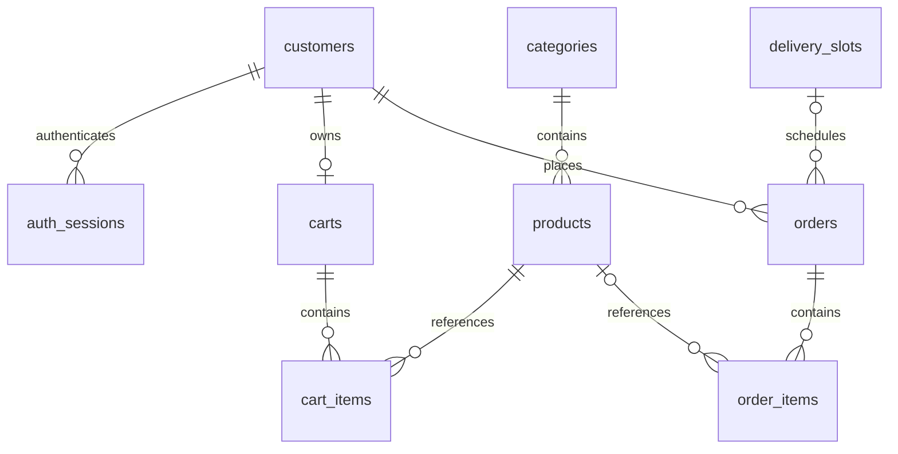
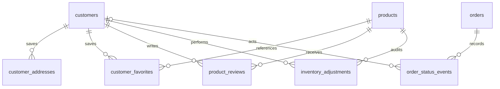

# Foodwell database

The schema covers the resources planned in `docs/openapi.yaml` and `Part1_C.txt`,
plus account roles and session storage for Build 3. Creating tables does not
implement the planned API endpoints or authentication.

| Table | Purpose |
|---|---|
| categories | Grocery categories; existing Build 1 fields unchanged |
| products | Catalog, price and stock; existing Build 1 fields unchanged |
| customers | Profile, unique email, password hash, customer/staff/admin role |
| auth_sessions | Hashed opaque session tokens, expiration and revocation |
| carts | One reusable cart per customer |
| cart_items | Product quantities; one row per product per cart |
| delivery_slots | Delivery windows, capacity and active flag |
| orders | Customer, delivery address snapshot, status, total and optional slot |
| order_items | Purchased product name, unit, quantity and price snapshots |

## Installation

**New or disposable development database:** `composer db:setup` uses `schema.sql`
and the existing synthetic category/product seed. It drops **all 14 tables**
before recreating them. The seed also includes 4 demo accounts (2 customers, staff and admin), 2 expired/revoked sessions, 2 carts, 2 cart items, 4 delivery slots, 5 orders covering every status, and 6 order lines. All demo accounts use password `FoodwellDemo!2026`, stored as a bcrypt hash. Login is not implemented yet. Never use these demo accounts in production. Future delivery windows are relative to the UTC import date. `--empty`
creates all tables without sample data.

**Existing Build 1 database:** back it up, select it in your MariaDB client, then
execute `database/migrations/002_full_project.sql`, then `database/migrations/003_project_expansion.sql`, once each. A nine-table database needs only migration 003. It creates only the seven
new tables; it does not drop or alter categories or products. Do not run it after
the full schema or rerun it: existing table names intentionally cause an error.
MariaDB DDL implicitly commits, so restore from backup if a migration fails partway.

## Relationships

The old `ERD.png` depicts Build 1 only. The diagram above shows the original nine-table foundation; the expansion relationships are below.

## API mapping and application rules

- Map SQL snake_case to the existing API camelCase (for example `first_name`
  to `firstName`, `delivery_address` to `deliveryAddress`).
- Store `password_hash()` output, verify with `password_verify()`, and never
  return hashes. Registration must set `role = 'customer'`; only authorized
  administrators may grant staff/admin roles. Deactivate accounts with
  `is_active = 0`. Role enforcement and login remain application work.
- Session design is an opaque bearer token option for Build 3. Generate tokens
  securely, store only their SHA-256 hex digest, and check expiry, revocation
  and account activity on every authenticated request. This is not a JWT table.
- Normalize and validate emails before storage. The unique email column uses
  case-insensitive collation. Validate all input in PHP; existing product
  columns remain unchanged, including their original validation limitations.
- Use UTC for all DATETIME values and configure database connections accordingly.
  Convert delivery date filters from the store's local timezone to UTC ranges.
- Cart `unitPrice` comes from current `products.price`; subtotal is computed as
  the sum of quantity times current price. Cart contents do not reserve stock.
  Update the cart's `updated_at` when adding/changing/removing a line.
- Checkout must run in one transaction: lock the customer/cart and product rows
  in a consistent order, reject an empty cart or insufficient stock, capture
  product name/unit/price and address, compute total with decimal arithmetic,
  decrement stock, create order lines, and empty the cart. Never trust a
  client-supplied price or total. Currency is CAD; taxes, payment processing,
  coupons and delivery fees are not specified by the current project contract.
- `delivery_slot_id` is nullable so Build 2 checkout works before Build 3 slot
  selection. For slot booking, lock the slot row and count its non-cancelled
  orders in the same transaction; reject inactive, past or full slots. Capacity
  and aggregate order totals cannot be enforced by row-level CHECK constraints.
- Status values match OpenAPI: `pending`, `packed`, `out_for_delivery`,
  `delivered`, `cancelled`. Enforce transitions in PHP. Cancellation must restore
  stock once and free capacity transactionally; terminal states cannot transition.
- Deleting a product removes its cart entries and nulls its order-line reference;
  purchase snapshots remain readable. `OrderItem.productId` may therefore be
  null and the API contract should reflect that when order routes are implemented.
  Customers with orders, booked slots and orders with lines cannot be hard deleted.
  Deactivate customers/slots or cancel orders instead. Deleting an unused customer
  removes its cart and sessions.

## Schema verification

`php scripts/check-schema.php` checks fresh setup, rerunnable development reset,
the additive migration, original seed preservation, uniqueness, CHECK constraints,
foreign keys and historical order retention using temporary databases. It needs
a local MariaDB account with CREATE/DROP DATABASE privileges. It defaults to
`127.0.0.1:3306`, user `root`, empty password; override with `SCHEMA_TEST_HOST`,
`SCHEMA_TEST_PORT`, `SCHEMA_TEST_USER`, `SCHEMA_TEST_PASS`. It does not load `.env`
or modify the configured application database.

## Expanded resources

| Table | Purpose |
|---|---|
| customer_addresses | Customer-owned saved delivery addresses |
| customer_favorites | Unique customer/product favorites |
| product_reviews | Customer/product ratings and comments |
| inventory_adjustments | Manual stock changes and actor/balance audit |
| order_status_events | Order lifecycle events and migration baselines |

Products now have is_active; new rows default to true. Existing product GET behavior is unchanged. Products with inventory history must be deactivated instead of deleted. Fresh schema/seed uses all 14 tables; migrations preserve existing records and add baseline events for old orders.

See [the setup guide](../README.md) for install paths, actor/ownership rules and the application work still required. Aggregate capacity, stock transactions, permissions and append-only audit behavior are application responsibilities.
